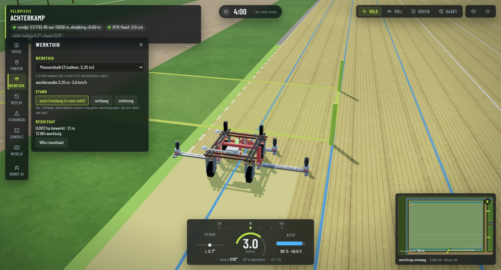
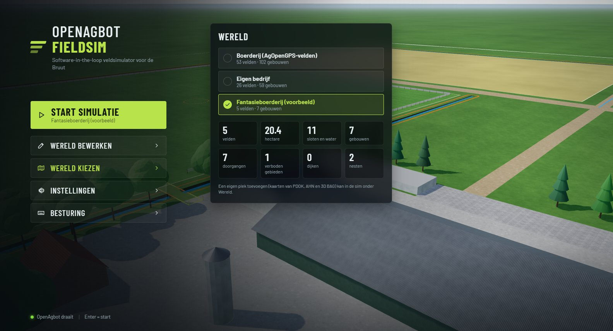
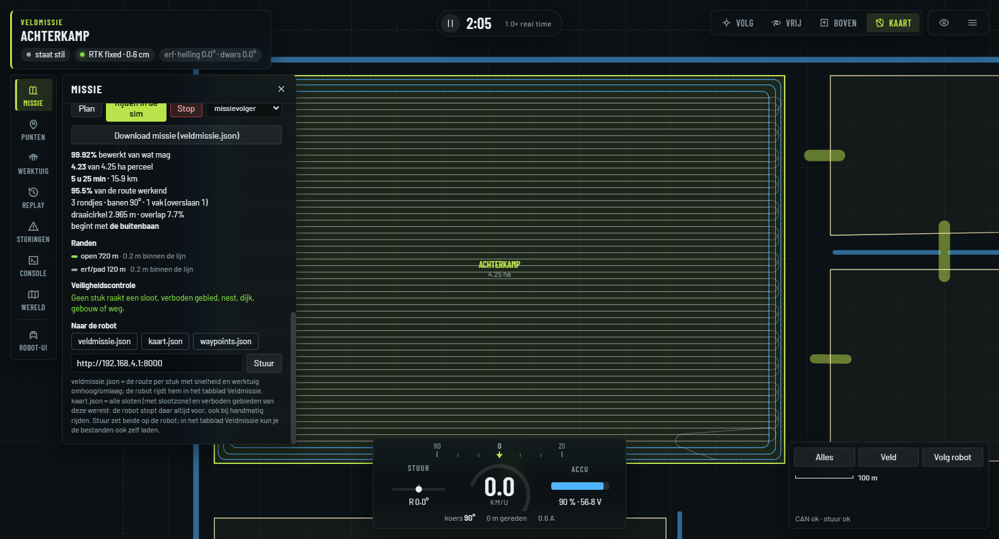
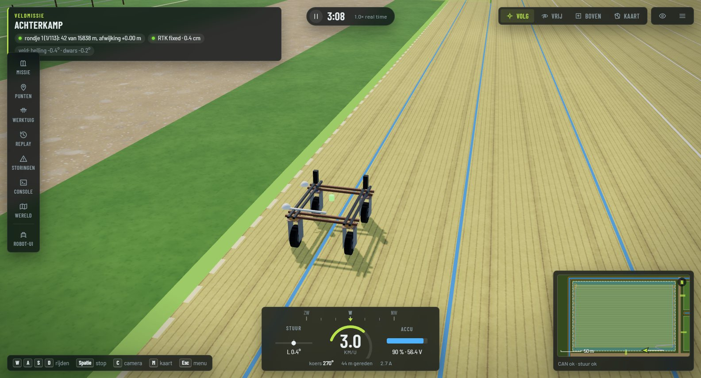
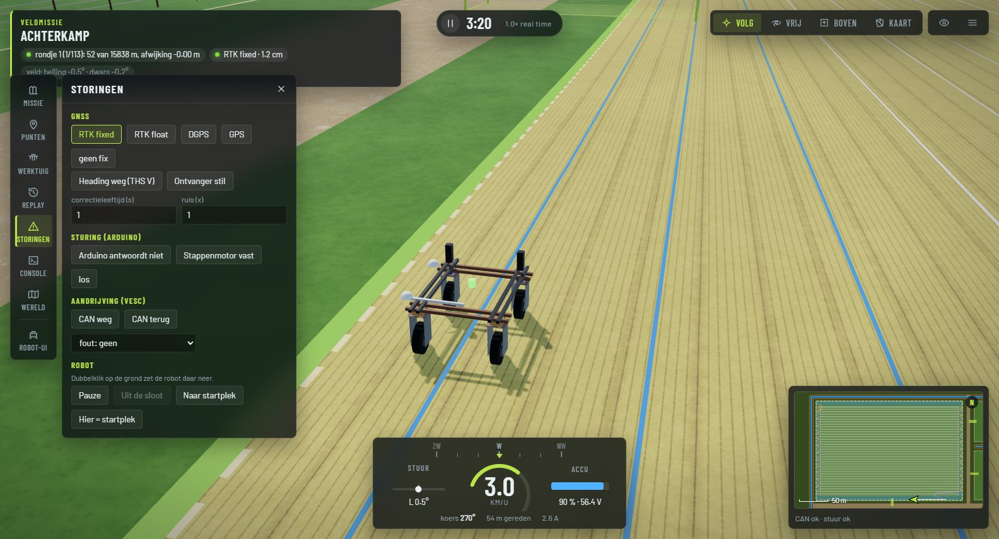
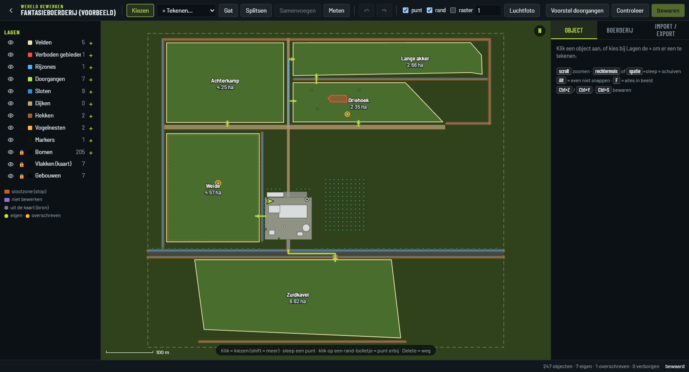

# OpenAgbot FieldSim

<p align="left">
  <a href="https://github.com/JacobsFarm/Bruut_OpenAgbot"></a>
  <a href="https://www.youtube.com/@opensource_agbot/videos"></a>
  <a href="https://jacobsfarm.github.io/Bruut_openagbot_website/"></a>
  
  <a href="LICENSE"></a>
</p>

Software-in-the-loop field simulator for the [Bruut OpenAgbot](https://github.com/JacobsFarm/Bruut_OpenAgbot).
The **real robot software** drives through a 3D farm as if it were running on the Jetson: the sim emulates the
GNSS receiver (ZED-X20D), the steering Arduino and both VESCs on their own protocols. Everything above the drivers
(navigator, Stanley controller, headland turns, safety, logger, web interface) runs unchanged.

Plan missions for a whole field or the whole farm, drive them in the sim, inject faults and replay ride logs from
the real robot, all before you go out to the field. Design notes and background (Dutch): [PLAN.md](PLAN.md).



> The interface itself is in Dutch. Button and panel names below are given as they appear on screen, in *italics*.

## Contents

- [Install and run](#install-and-run)
- [Tour](#tour)
- [Features](#features)
- [Fleet: following real robots](#fleet-following-real-robots)
- [Lanes: fixed driving lines with a zone](#lanes-fixed-driving-lines-with-a-zone)
- [Worlds](#worlds)
- [World editor](#world-editor)
- [Implements](#implements)
- [Building an .exe](#building-an-exe)
- [Files](#files)
- [Tests](#tests)
- [Estimated, not measured](#estimated-not-measured)

## Install and run

You need Python 3.11+ (3.12 recommended), [uv](https://docs.astral.sh/uv/), Node (only to build the UI) and a
checkout of [Bruut_OpenAgbot](https://github.com/JacobsFarm/Bruut_OpenAgbot).

```bash
uv venv --python 3.12
uv pip install -e .[app,dev]
cd ui && npm install && npm run build && cd ..
```

`npm run build` writes the UI to `openagbot_fieldsim/static` (not in git). Then:

```bash
.venv\Scripts\python -m openagbot_fieldsim
```

or double-click `start_simworld.bat` (always uses the project's own `.venv`, also from an Anaconda prompt).

| Option | What |
| --- | --- |
| `--world NAME` | pick a world (default `example`, or `world` in `settings.json`) |
| `--browser` | open in your normal browser instead of a separate window |
| `--headless` | server only, at `http://127.0.0.1:8765` |
| `--no-agbot` | just look at the world, without OpenAgbot |
| `--make-example` | regenerate the fantasy example world |

The sim looks for OpenAgbot in `F:\Agbot\Bruut_OpenAgbot`; otherwise set `FIELDSIM_AGBOT_DIR` or `agbot_dir` in
`settings.json` next to the worlds. OpenAgbot runs as a subprocess on port 8000 with `data/config.sim.json`
(via `AGBOT_CONFIG`): GNSS and steering Arduino over TCP (`socket://`, ports 5101 and 5102), the VESCs through the
python-can interface `simcan`.

## Tour

**Main menu.** Pick a world, start the simulation, edit the world, settings and controls. On the right, the key
numbers of the selected world.



**Planning a field mission.** Pick a field, work width, number of headland rounds and swath direction, and press
*Plan*. The map view (`M`) shows the rounds and swaths; the panel shows coverage, time, efficiency, what lies along
each edge and the safety check. Then *Rijden in de sim* (drive in the sim) or *Stuur* (send to the real robot).



**Driving.** The real OpenAgbot drives the mission: progress and cross-track deviation at the top, steering angle,
speed, heading and battery at the bottom, mini map at the bottom right. Cameras: follow, free, top-down or map.



**Faults.** Drop the RTK fix, lose the heading, jam the stepper motor or pull the CAN bus, and see what the
software does.



**World editor.** Draw fields, ditches, dikes, crossings, no-go zones and bird nests in a top-down view; import and
export for AgOpenGPS, KML and GeoJSON.



The robot has its own web interface; the sim opens it under *Robot-UI*, exactly as on the phone in the field.
Screenshots of it are in the [Bruut_OpenAgbot README](https://github.com/JacobsFarm/Bruut_OpenAgbot#web-interface).

## Features

### Missions

- *Veldmissie* (field mission): the whole field as one path. First a number of rounds along the edge (or last, or
  none), then the middle in straight swaths, with turns the robot can actually drive (Dubins, turning radius from
  the config). Per edge type (ditch, road, fence, building) you set how far it stays away. *Plan* shows the path,
  the edges in colour and the numbers (coverage, time, efficiency); *Rijden in de sim* drives it with the real
  software as a waypoint route; download `veldmissie.json` / `waypoints.json` or *Stuur* it to the real robot.
  See PLAN.md 5a.
- *Boerderij* (farm): several fields in a row. The planner picks the order (always the nearest field next), plans
  each field and drives between them as transport, **only through crossings** (dam, culvert, bridge, gate, road
  crossing). A field without a crossing is left out of the mission and listed with the reason. See
  [World editor](#world-editor).
- *AB-lijn* (AB line): set work width and headland; *Opslaan + start* writes the mission to
  `runtime/agbot/data/ab_line.json` and starts it through the robot's API. OpenAgbot works out the order and the
  turns itself; the sim draws the path the robot plans.

Settings that shape the path:

- **Headland**: only the outer round follows the winding edge; round 2 and further are straightened (wiggles up
  to the set size, 1 m by default), so a bend along the ditch fits in one pass and the swaths end on a straight
  headland. A straightened round overlaps the outer one by at most that size and never leaves a strip unworked.
  Can be switched off per mission. Up to 6 swaths can be skipped between passes.
- **Max overlap last swath** (0-100 %, default 100 = off): the last swath rarely fits exactly and then slides over
  its neighbour. If it overlaps more than this percentage of the work width, it is dropped and the narrow strip is
  left on the side of the field closest to the ditch (no ditch: at the end of the swaths). Saves an almost double
  pass at the cost of that strip.

### Safety

- **Before driving**: every planned route is checked, with the width of robot and implement, against ditches,
  water, no-go zones, bird nests (within their season), dikes, buildings and roads. A piece that touches one turns
  red, and the sim will not drive that mission (or send it to the robot).
- **While driving** the monitor checks the corners of robot and implement 20 times per second: in a no-go zone or
  in the ditch zone the sim pauses, the sim robot gets a stop and a message appears.
- **Ditch zone**: a no-go strip along every ditch and body of water, set per farm (*Wereld bewerken* ->
  *Boerderij*, 2 m by default; orange in the editor, the mini map and 3D). Entering it means stop. Missions are
  planned outside it automatically: the clearance to water is at least the ditch zone plus the planning margin
  (0.3 m), even if a mission asks for less. At a crossing the zone is open, including the approach to the field.

### Driving, faults and replay

- **Driving**: arrow keys or WASD (via `POST /api/nav/manual_drive`, so with the real dead-man switch), space = stop.
- **Faults**: GNSS fix (fixed/float/DGPS/none), heading lost, receiver silent, Arduino not responding, stepper
  jammed, CAN down, VESC fault code. Shows what the software does when things go wrong in the field.
- **Replay**: pick a ride log (from the sim, from the robot's `data/logs` or from `worlds/<name>/logs`), play it
  back with heading, steering angle, speed and deviation, and *Route in de sim narijden* (re-drive the route in
  the sim with waypoints + the robot's pure pursuit).
- **Console**: output of the OpenAgbot backend and sim events (ditch, collision).
- **Robot-UI**: the robot's real web interface in a window (the same as on the phone in the field).

Ride logs of simulated runs go to `runtime/agbot/data/logs/` (same CSV format as on the robot).

### Points, worlds and display

- **Points**: place GPS points (double-click), import weeds (CSV `lat, lon, name` or GeoJSON points) or generate
  test plants in a field, *Volgorde optimaliseren* (shortest route from the robot), *Rijden in de sim* (waypoints +
  pure pursuit of the real software), download `waypoints.json` or *Stuur* to the real robot (only replaces the
  waypoints there, starts nothing). Points are saved in `worlds/<name>/missions/punten.json`.
- **World**: open worlds, add a real location and build it, toggle layers.
- **Aerial photo**: under *Weergave*, *Luchtfoto (PDOK)* drapes the aerial photo over the 3D terrain (tiles of 2048
  pixels, cached in `worlds/<name>/cache/luchtfoto`). Only the world's bounding box is sent to PDOK.

## Fleet: following real robots

The sim doubles as a small fleet manager. Add the address of a robot in the *Vloot* (fleet) tab and it shows up
live in the loaded world, next to the simulated robot: its model at the measured position and heading, a name tag,
its driven track, and its arrow on the minimap and the 2D map. The robot's own web interface keeps working as
before; the sim only reads along over the same HTTP API.

```
phone / tablet ──► robot web interface (port 8000) ◄── FieldSim fleet (5 Hz telemetry, commands on request)
```

| In the fleet tab | What |
| --- | --- |
| Status per robot | online / offline, speed, GNSS fix, battery, connection delay, mission progress, faults, geofence |
| **Follow** | camera, drive HUD and map follow that robot; the top-left panel shows `LIVE` with a stop button |
| **Stop** / **Stop all** | emergency stop for one robot or the whole fleet (also `Space` while following) |
| Missions on the robot | start, resume or stop a mission that is stored on the robot (asks for confirmation: it drives off) |
| Send safety map | ditches and no-go zones of the loaded world to the robot's geofence |
| Target for missions | *Send to the robot* in the mission and points panels then goes to this robot |
| Robot UI | the robot's own web interface in a window inside the sim |

Things to know:

- **The world must contain the field.** Positions are converted from lat/lon to the loaded world. A robot outside
  it is listed with a warning and not drawn; open (or build) the world of the place where it drives.
- **Run the sim on a laptop or PC** on the same network as the robot (WiFi or the robot's hotspot), not on the
  Jetson: the 3D view would take CPU and GPU the control loop needs.
- **Reading is always safe.** The sim never drives a real robot by itself; the arrow keys only drive the simulated
  robot. Driving starts only from a mission you start and confirm.
- The list is stored in `fleet.json` next to `settings.json` (contains addresses, not in git). A robot that drops
  out stays on the map as offline at its last position and reconnects by itself.

No robot at hand? `python tools/demo_robot.py` starts an imitation robot that drives a circle near the yard of the
example world; add `http://127.0.0.1:8101` in the fleet tab.

Other kinds of robots: write a subclass of `RobotAdapter` (`openagbot_fieldsim/fleet/adapters.py`) that translates
its API to `Telemetry` and call `register("kind", Class)`. The manager, the API (`/api/fleet...`, see
`api/fleet_api.py`) and the UI work with any registered kind.

## Lanes: fixed driving lines with a zone

A **lane** (*rijpad*) is a fixed line the robot follows between fields and across the yard, with a zone around it.
Draw one in the world editor as a crossing of the kind `rijpad`: the line is the path, the width is the zone.

| Rule | What happens |
| --- | --- |
| Strict line | Outside the fields the robot drives on the drawn line, like an AB line. Only corners are rounded on its turning circle. |
| Zone | The line plus half the width on each side is the only place outside the fields where it may be during the mission. The mission file carries the zone as allowed area and as the width of the segment; the robot stops when it leaves it. |
| Picking up | Robot inside a zone: it picks up the line by itself and continues. Robot in a field: it takes the shortest way through the field to the lane. Anywhere else the planner refuses and tells you how far the nearest lane is: drive it there by hand first. |
| Turns | A corner or junction whose rounded turn does not fit inside the zones is refused, with the reason (run-up needed, turning circle). Make the corner wider or the zone broader there. |
| Network | Lanes that touch or cross are connected. A lane that runs into a field connects that field. Gates and dams may end on a lane. |
| Safety | A lane never opens a ditch, dike or road: crossing one still needs a dam, culvert, bridge or road crossing, with the lane drawn over it. |

As soon as a world has lanes, free driving over the yard and farm tracks is switched off (`transit_mode: auto`).
Farm setting `transit_mode` can force `rijpaden` (strict) or `vrij` (free areas and lanes together).

In the farm mission panel *route begint* picks where the route starts: the world's start spot, where the simulated
robot stands now, or where a real robot from the fleet stands now.

## Worlds

A world is a folder `worlds/<name>/` with a `world.json` (lat/lon, ETRS89). See PLAN.md chapter 4.

| World | What |
| --- | --- |
| `example` | Fantasy farm, in git: yard with farmhouse, cubicle barn, machine shed, open barn, manure and feed silos, bunker silo; five fields (Achterkamp, Lange akker, Driehoek, Weide, Zuidkavel), ditches with dams, a road, avenue trees, orchard, fencing, gentle relief. With crossings: gates to the fields, a dam over the ditch between Driehoek and Lange akker, a dam to the Weide and a road crossing to the Zuidkavel. Generated by `openagbot_fieldsim/world/fantasy.py`. |
| your own | Built from Dutch open map data (BRP, BGT, AHN, 3D BAG via PDOK) or imported from AgOpenGPS. Not in git. |

To make your own location: tab *Wereld*, fill in a name and corner points (lat, lon), *Maak*, then *Bouw*. Or:

```bash
.venv\Scripts\python -m openagbot_fieldsim.world.builder my_farm
```

Field boundaries come from the BRP crop parcels of RVO (via PDOK), so the boundaries as registered with RVO. The
builder also fetches the cadastral parcels (BRK) and the BGT separations (fence, sheet piling, bank protection);
fences become fencing in the sim, the rest is used by the mission planner. Without BRP parcels, cadastral parcels
in grassland or arable land become the fields. To update only these layers in an already built world:

```bash
.venv\Scripts\python -m openagbot_fieldsim.world.builder my_farm --boundaries
```

The builder fetches BGT and BRP in CRS84 from PDOK (PDOK converts from RD correctly), AHN (DTM 0.5 m) and 3D BAG in
RD, and ties RD to the sim with an affine fit on the same BGT objects in both systems (residual < 1 mm). Water
from the BGT is dug into the terrain and used as a no-go zone. Downloads stay in `worlds/<name>/cache/`, so a
rebuild works offline. Start position: the yard closest to the centre, or set it yourself (double-click on the
ground, then *Hier = startplek* in the faults panel).

`worlds/*` is in `.gitignore` except `worlds/example/`: a real world contains your own location.

## World editor

*Wereld bewerken* opens the selected world in a top-down view (north up, metres). What you draw or change goes into
`worlds/<name>/farm.json`; `world.json` stays the source data from the map. So *Bouw* can run again without losing
your work. Every object has a fixed id; a changed source object is "overridden", a removed source object "hidden"
(and can be restored). Every save moves the previous version to `backups/`.

| Object | What it does |
| --- | --- |
| Field | boundary, holes (drivable or not), default number of headland rounds and work width |
| Ditch | width, depth, water level; cannot be crossed except at a crossing |
| Dike | crest width, height, slope; mode `ontwijken` (avoid), `negeren` (ignore) or `doorgang` (only over at a crossing). Raises the terrain |
| No-go zone | `stoppen` (robot stops as soon as it enters) or `mijden` (planner drives around it, warning only) |
| Drive zone | `werken` (work), `alleen_rijden` (drive only: transport, implement up), `niet_bewerken` (do not work) or `verboden` (forbidden). **Do not work** (purple) is part of a field the mission skips, such as a point or bulge: rounds and swaths follow the rest of the field, but the robot may still drive and turn there. A **drive only** zone in a corner or along the edge also takes the field mission out of the work area: rounds and swaths follow the zone line, so a diagonal zone across a sharp corner gives a wide turn instead of odd swaths. If the zone cuts the field into pieces (a track across the field), the swaths run through it with the implement up |
| Crossing | drive line with width, type (dam, culvert, bridge, gate, road crossing, ramp), direction, speed limit and "stop first and wait for release". The only place where the robot may cross a ditch, dike, fence or road, and go from field to field |
| Bird nest | point with radius and season (e.g. 03-15 to 08-15); outside the season it does not count |
| Marker | stone, post, manhole, cable: a point to drive around |
| Tree, fence | tree with its own clearance; fence as a line |

Drawing: polygon, line and point; drag points, add them (dot on an edge) and delete them; snapping to vertices,
edges and a grid (hold Alt to disable); measuring tape; undo and redo. Per field: split with a line, merge, draw a
hole, offset the edge inwards or outwards, simplify. Layer panel with visible and locked, properties panel, PDOK
aerial photo as background. Under *Boerderij*: dike mode for all dikes, clearance per obstacle type and the monitor
settings. *Voorstel doorgangen* (suggest crossings) looks for places where two areas touch without a ditch, fence
or road in between (at a dam the ditch is interrupted in the map); *Controleer* (check) shows which fields have no
usable crossing and where the robot may drive.

### AgOpenGPS, KML and GeoJSON

*Import / export* reads an AgOpenGPS field folder (or the folder with all your fields), KML and GeoJSON. The outer
boundary becomes a field, inner boundaries become holes ("drive through" stays drivable), flags become markers
("nest" or "boom" in the note turns it into a nest or tree). The conversion from AgOpenGPS' local metres to lat/lon
is the same as in AgOpenGPS itself (`world/interchange.py`); thousands separators from newer versions
(`1,234.500`) are read correctly. Back to AgOpenGPS: `Field.txt`, `Boundary.txt`, `Flags.txt` and `Field.kml` per
field (zip); ditches, dikes, no-go zones and nests inside a field are exported as holes, because AgOpenGPS has no
such objects. GeoJSON holds all layers with all properties: use it to copy a farm to another world (or *Neem over*).

A second farm from AgOpenGPS fields, with a check of the conversion against the `Field.kml` AgOpenGPS wrote itself
and a round-trip test:

```bash
.venv\Scripts\python tools/import_agopengps.py "C:/path/to/Fields" --check
.venv\Scripts\python tools/import_agopengps.py "C:/path/to/Fields" my_farm --build
```

On 12 real fields: boundary within 0.7 cm of AgOpenGPS' KML (which rounds to 7 decimals), round trip within
0.1 mm. With `--build` the map is added and BRP parcels lying under one of your own fields are hidden.

## Implements

Tab *Werktuig*: mower bar (3 bars, 3.25 m), dock-weed drill v8 and the advanced V2 liquid manure injector
(5 rows). The models come from the FreeCAD build scripts in `F:\veldrobot\aanbouwdelen`, in working and raised
position.

- **Position:** *auto* = down as soon as the robot is in a field, up outside; or fixed down/up. OpenAgbot does not
  control an implement yet, so the sim does it itself.
- **Strip** (mower bar, injector): worked strip in the implement's colour, hectares, litres (dose in l/ha),
  implement energy (also drawn from the battery).
- **Drill:** the points from the *Punten* tab are the plants. Per plant: *geboord* (drilled: the robot stood still
  with the spindle above the plant for the whole 21.8 s cycle), *te snel voorbij* (passed too fast: within the
  ±50 cm X stroke, but did not stop) or *buiten bereik* (out of reach). The X slide moves to the plant; the plants
  change colour accordingly.

Re-export the models after changing an implement (headless FreeCAD, writes nothing into the implements folder):

```bash
"C:\Program Files\FreeCAD 1.1\bin\freecadcmd.exe" tools\export_implements.py
```

Adding an implement: an `ImplementSpec` in `openagbot_fieldsim/implements/catalog.py` and a recipe (which
positions) in `tools/export_implements.py`. Mounting is per axle: the implement keeps its distance to the front or
rear axle of the FreeCAD model, even though the sim robot (config) has a different wheelbase.

## Building an .exe

```bash
.venv\Scripts\python packaging\build_exe.py --with-agbot F:\Agbot\Bruut_OpenAgbot
```

Result: `dist/openagbot-fieldsim/openagbot-fieldsim.exe` with the example world and (with `--with-agbot`) a copy of
the OpenAgbot code without your own config, ride logs or weights. `--installer` turns it into a setup.exe with
Inno Setup. The OpenAgbot backend runs as a second process of the same .exe (`openagbot-fieldsim.exe --agbot-runner`).

## Files

| Path | What |
| --- | --- |
| `openagbot_fieldsim/geo.py` | lat/lon <-> local ENU (exact via ECEF), compass headings |
| `openagbot_fieldsim/world/model.py` | world format (`world.json`): fields (with holes), areas, ditches, buildings, trees, fences, dikes, no-go zones, drive zones, crossings, nests, markers; fixed ids |
| `openagbot_fieldsim/world/farm.py` | `farm.json`: your own edits on top of the source data (hidden, overridden, own objects), backups |
| `openagbot_fieldsim/world/interchange.py` | AgOpenGPS field folder, KML and GeoJSON import and export |
| `openagbot_fieldsim/world/terrain.py` | height grid (flat, procedural or AHN raster), digging ditches, levelling the yard |
| `openagbot_fieldsim/world/fantasy.py` | the fantasy world `example` |
| `openagbot_fieldsim/world/builder.py` | world builder for a real location (BGT, BRP, AHN, 3D BAG via PDOK) |
| `openagbot_fieldsim/world/sources/` | cached downloads, AHN GeoTIFF reader (own decoder for the float predictor) |
| `openagbot_fieldsim/replay/ride_log.py` | reading ride logs, key figures (like extract_ride_report.py), route as waypoints |
| `openagbot_fieldsim/vehicle/params.py` | robot dimensions from the OpenAgbot config (single source) plus `SimExtras` (estimated) |
| `openagbot_fieldsim/vehicle/model.py` | vehicle model: Ackermann front wheels, VESC rear wheels, slip, terrain, ditch/building |
| `openagbot_fieldsim/devices/gnss.py` | ZED-X20D: GGA/RMC/VTG/THS + UBX NAV-DAHEADING at 25 Hz, noise per fix type, mounting errors |
| `openagbot_fieldsim/devices/steering.py` | steering Arduino: same protocol and step ramp as the firmware |
| `openagbot_fieldsim/devices/vesc.py` | VESC: SET_RPM/BRAKE/fault poll, STATUS 1-5, min eRPM and timeout like the real one |
| `openagbot_fieldsim/devices/can_link.py` | CAN over TCP + python-can interface `simcan` |
| `openagbot_fieldsim/devices/transport.py` | TCP ports for `socket://` (pyserial) |
| `openagbot_fieldsim/engine.py` | the loop (200 Hz): steering, drive, vehicle, GNSS epochs, faults, snapshot |
| `openagbot_fieldsim/agbot/` | OpenAgbot as a subprocess in `runtime/agbot` (own `data/`) |
| `openagbot_fieldsim/missions/ab.py` | AB mission per field in the `ab_line.json` format |
| `openagbot_fieldsim/missions/boundary.py` | field edge: what lies next to it (ditch, road, fence, building, neighbouring parcel) and the allowed work area |
| `openagbot_fieldsim/missions/dubins.py` | Dubins paths (shortest forward path with minimum turning radius) for turns and transitions |
| `openagbot_fieldsim/missions/field_plan.py` | field mission: headland rounds, swaths, order, turns, coverage; outputs `veldmissie.json` and `waypoints.json` |
| `openagbot_fieldsim/missions/safety.py` | hazards (stop / avoid), route check before driving, monitoring while driving, geofence for the robot |
| `openagbot_fieldsim/missions/farm_route.py` | route graph (fields, drive areas, crossings), farm mission, crossing suggestions |
| `openagbot_fieldsim/missions/lanes.py` | lanes: zone around a fixed line, rounding corners on the turning circle |
| `openagbot_fieldsim/missions/points.py` | point missions: import, test weeds, shortest route (nearest neighbour + 2-opt), `waypoints.json` |
| `openagbot_fieldsim/implements/` | implements: catalogue (source, mounting, width), behaviour (strip / points), `assets/` (glb from FreeCAD) |
| `openagbot_fieldsim/api/` | HTTP/WebSocket API and scene export for the UI |
| `openagbot_fieldsim/api/field_api.py` | API for field missions (plan, download, drive in the sim, send to the robot) |
| `openagbot_fieldsim/api/farm_api.py` | API for the farm mission, the route graph and safety |
| `openagbot_fieldsim/fleet/` | fleet: robot list (`fleet.json`), one connection per robot, adapters per kind of robot |
| `openagbot_fieldsim/api/fleet_api.py` | fleet API: add robots, live state, stop, missions, safety map |
| `openagbot_fieldsim/api/editor_api.py` | editor API: state, save, split/merge/offset, import/export, aerial photo |
| `tools/import_agopengps.py` | check AgOpenGPS fields and set them up as a new world |
| `tools/render_field_plan.py` | field mission as SVG/PNG, without the sim |
| `tools/drive_field_mission.py` | let the real OpenAgbot drive a field mission (no UI) and measure the deviation |
| `tools/check_boundaries.py` | check field boundaries: BRP (RVO) against the cadastre and water |
| `tools/demo_robot.py` | imitation robot (OpenAgbot API, drives a circle) to try the fleet without hardware |
| `tools/export_implements.py` | FreeCAD build scripts -> glb per position + `meta.json` (spindle position, cycle time, dose) |
| `ui/` | Svelte + three.js, FreeCAD-style theme (`ui/src/theme.js`); `npm run build` -> `openagbot_fieldsim/static` |
| `packaging/` | PyInstaller spec, build script, Inno Setup |
| `tests/` | unit tests and integration tests against the real OpenAgbot drivers |

## Tests

```bash
.venv\Scripts\python -m pytest -q                 # everything, including the integration tests (about 1 min)
.venv\Scripts\python -m pytest -q -m "not integration"
```

The device tests drive the emulators with OpenAgbot's **real** `gps_logic.py`, `stepper_logic.py` and
`vesc_can.py`. The integration test starts the whole backend, drives by hand (and checks the dead-man switch) and
drives swath 0 of an AB mission: deviation < 10 cm.

## Estimated, not measured

- Vehicle: mass 180 kg, rolling resistance 0.06, yaw efficiency 0.97, VESC response time 0.15 s, current per force
  (about 9 A at 150 N per wheel). To be calibrated on ride logs (PLAN.md phase 4).
- GNSS noise per fix type (fixed 8 mm, float 12 cm, DGPS 45 cm, GPS 1.5 m) and heading noise 0.08°.
- Implements: mower bar power 2.2 kW (sbm_calc, at 1 m/s in 3 t DM/ha), injector 150 W, drill 600 W while
  drilling; the drill must stop within 5 cm in front of/behind the plant.
- Antenna baseline 0.997 m (from the ride log of 2 Nov 2026).
- Battery: linear open-circuit voltage 3.30-4.15 V per cell.
- Robot dimensions in 3D: from the OpenAgbot config (wheelbase 1.20 m, track 1.00 m); the FreeCAD model in
  `agbots/agbot design` is smaller (1.00 x 0.75 m). Which one is right for the 2WD in the field is still to be
  confirmed.

## License

[AGPL-3.0](LICENSE)
